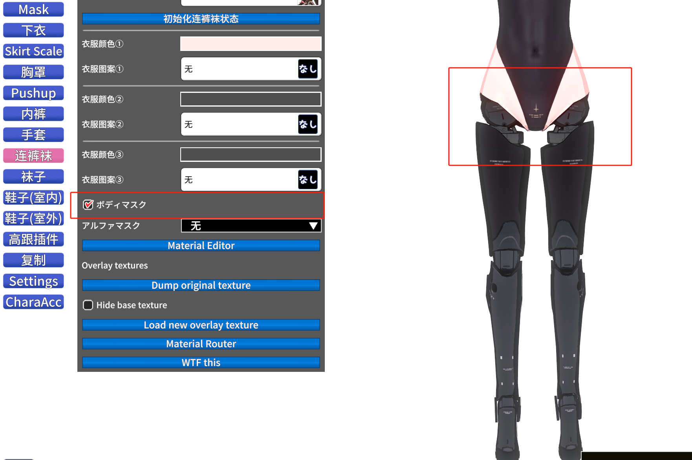
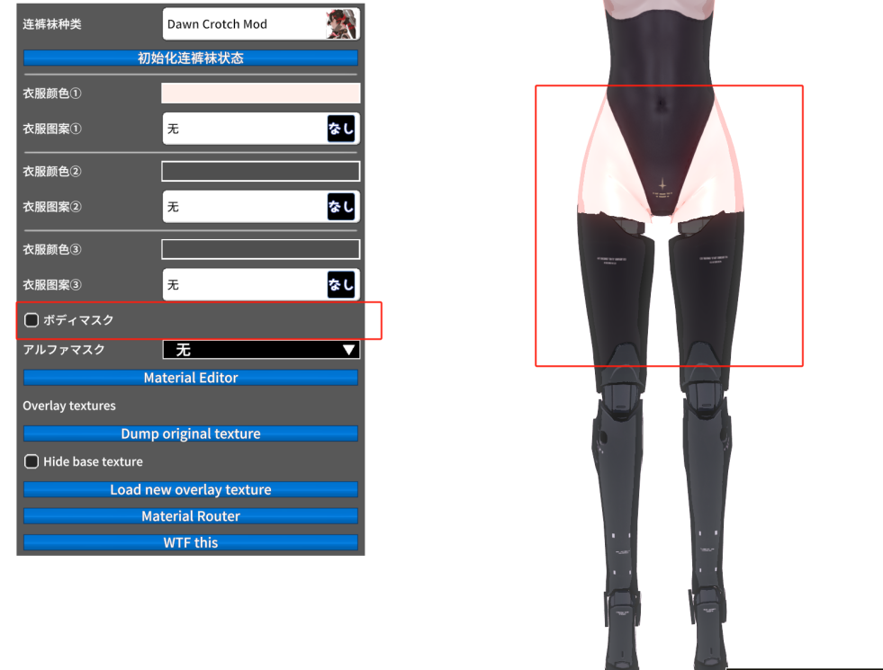
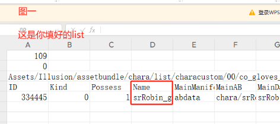
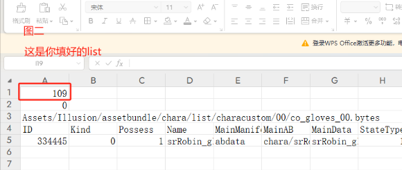
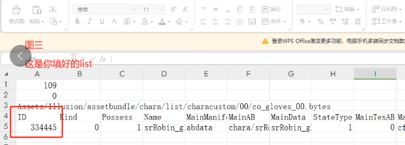
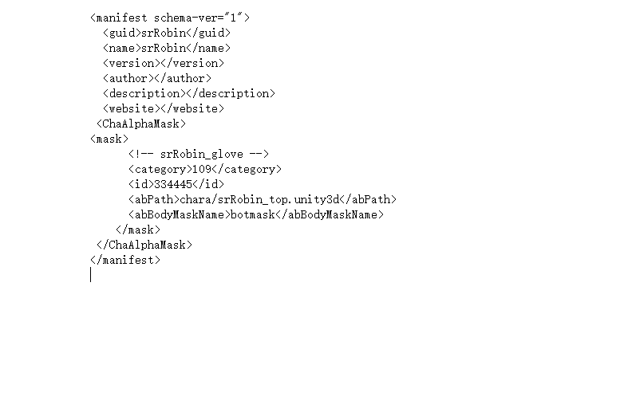
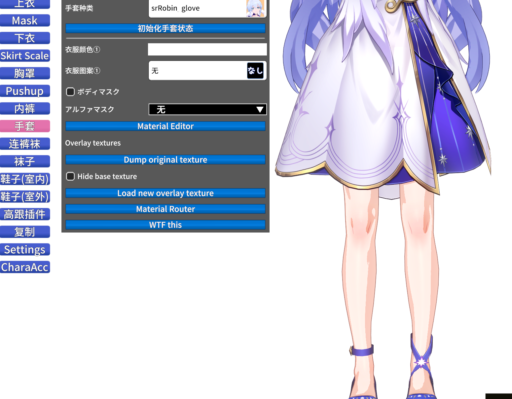
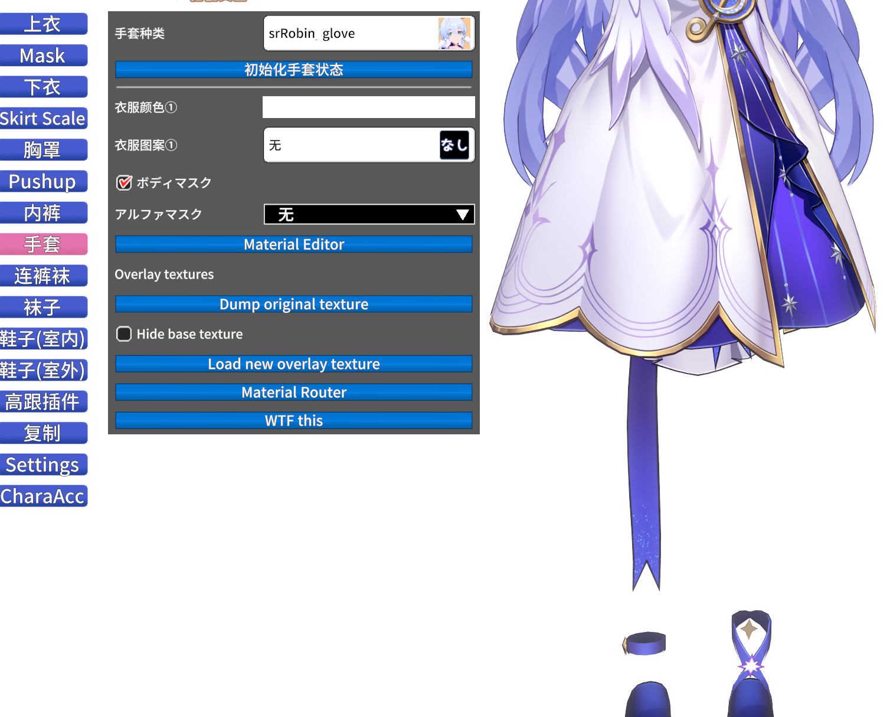

<h1 align="center">独立遮罩使用方法</h1>

> 改编自 春水《独立遮罩使用方法》。本教程面向有恋活 mod 制作经验的人，需要你已经会用 Sideloader 打包 zipmod。

在已有「身体遮罩（俗称黄绿图）」的基础上，为**单件衣服**额外添加属于自己的独立遮罩。衣服页面会多出两个控件：

- `ボディマスク`：身体遮罩开关
- `アルファマスク`：Alpha 遮罩下拉，可把某个部位的遮罩同步到其它部位的服装状态



同一件连裤袜，取消勾选后的效果对比：



---

## 一、绘制遮罩

画法与黄绿图相同，区别在于配色约定：

| 颜色 | 含义 |
|---|---|
| 纯黑 `RGB(0, 0, 0)` | 背景，不遮蔽 |
| 纯红 `RGB(255, 0, 0)` | 需要遮蔽的身体部位 |

> 颜色必须是纯黑 / 纯红，不能有渐变或半透明的杂边，否则边缘会出现毛刺。


文件名随意，只需记住它，后面要填进 manifest。

## 二、把遮罩放进 unity3d

用你平时打包 mod 的流程，把画好的遮罩贴图放进已经做好的 `unity3d` 文件里，记下资源名（例如 `botmask`）。

## 三、写 manifest.xml

打开 mod 的 `manifest.xml`，在 `<website></website>` 之后、`</manifest>` 之前加入：

```xml
<ChaAlphaMask>
  <mask>
    <!-- 图一 -->
    <category>图二</category>
    <id>图三</id>
    <abPath>你封包好的unity3d文件</abPath>
    <abBodyMaskName>放入unity3d遮罩的名称</abBodyMaskName>
  </mask>
</ChaAlphaMask>
```

`category` 和 `id` 从你的服装 list 文件里取，对应关系如下：

**图一** —— 你填好的 list（`abdata/list/characustom/` 下的服装 csv）：



**图二** —— `category`，取 list 第 1 行那个数字（下图为 `109`，代表手套）：



**图三** —— `id`，取 `ID` 列里对应衣服那一行的值（下图为 `334445`）：



> 缩进和换行只是为了好看，XML 本身可以压成一行；但标签必须成对闭合，`<` `>` 不能漏。

填完后完整的例子（`srRobin glove`）：



保存，替换原来的 `manifest.xml`，重开游戏即可。

## 四、游戏内验证

进入捏人 → 手套页，勾选 `ボディマスク`：

| 勾选前 | 勾选后 |
|---|---|
|  |  |

可以看到原本露出的腿部被遮罩挡住，只留下鞋子。

---

## 附：其它可用字段

除了上面两个必填项，`<mask>` 还支持以下可选字段：

| 字段 | 说明 |
|---|---|
| `abPath` | 遮罩贴图所在 AssetBundle，路径相对 `abdata/`（例如 `chara/srRobin_top.unity3d`） |
| `abBodyMaskName` | bundle 内的贴图资源名 |
| `pngBodyMaskPath` | 直接用 PNG 时使用，路径相对 `abdata/`（与 `abPath` 二选一） |
| `botMask` | 标记该遮罩用于下半身（ボトムス / ショーツ） |
| `objOpt01` / `objOpt02` | 与衣服的 Option 开关绑定，随开关状态启用遮罩 |
| `guid` | 一般省略，默认取 manifest 的 `<guid>` |

```xml
<ChaAlphaMask>
  <mask>
    <category>109</category>
    <id>334445</id>
    <pngBodyMaskPath>chara/srRobin/mask.png</pngBodyMaskPath>
    <botMask>false</botMask>
  </mask>
</ChaAlphaMask>
```

## 常见问题

- **衣服页面没有 `ボディマスク` 控件**：插件未加载。检查 BepInEx 日志里有没有 `Loading [Character Alpha Mask ...]`，并确认 KKAPI / Material Editor / Overlay Mods（KCOX）/ Sideloader 都已安装。
- **勾选了但没有任何变化**：多半是 `category` / `id` 与衣服对不上，或 `abPath` + `abBodyMaskName` 指向的资源不存在。日志里会打印 `Mask Texture missing` / `AssetBundle missing` 并带上 guid、category、id，方便定位。
- **遮罩边缘有锯齿或毛边**：贴图里有非纯黑 / 非纯红的像素，重新用黑色填充背景、红色补色。
- **KoikatuSunshine**：内履き（鞋子(室内)）槽位在 KKS 里没有独立的服装页，因此该槽位没有身体遮罩开关，其余部位正常。
